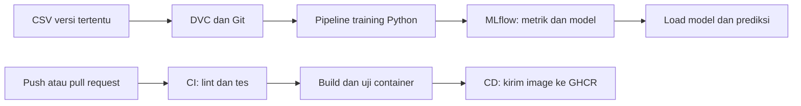

# Panduan Mengajar MLOps: House Price

Repository kelas: <https://github.com/bayuzen19/mlops_house_price>

Panduan ini untuk pengajar yang ingin mendemonstrasikan alur dari dataset sampai aplikasi ML dikemas dan dikirim ke GitHub Container Registry. Contoh memakai California Housing, Random Forest, DVC, MLflow, pytest, Docker, dan GitHub Actions. Bahasa perintah utama adalah PowerShell di Windows.

## 1. Tujuan dan batas praktik

Setelah praktik, peserta diharapkan bisa:

1. Menjelaskan peran Git, DVC, MLflow, Docker, dan GitHub Actions.
2. Memulihkan versi dataset tertentu dan membuktikan versinya melalui checksum.
3. Menjalankan training dari modul Python, tanpa bergantung pada urutan variabel notebook.
4. Menyimpan preprocessing bersama model, lalu memuatnya untuk prediksi.
5. Menjalankan tes sebelum perubahan kode dikirim ke GitHub.
6. Menelusuri proses CI sampai Docker image tersedia di GHCR.

Dalam kelas ini, CD berakhir pada pengiriman image ke GHCR. Menjalankan layanan prediksi pada server merupakan tahap lanjutan. Image yang dihasilkan berisi program training/prediksi; dataset dan model hasil training diberikan saat runtime melalui mount atau MLflow.

Dataset ini merupakan data historis untuk pembelajaran. Target `MedHouseVal` dinyatakan dalam satuan 100.000 USD. Nilai prediksi 2,5 berarti sekitar 250.000 USD pada satuan dataset, bukan estimasi pasar rumah masa kini.

## 2. Sasaran peserta dan agenda

Peserta sebaiknya sudah pernah menggunakan Python, pandas, train/test split, dan Git dasar. Tidak harus sudah menguasai Docker atau MLOps.

Contoh agenda empat jam, termasuk istirahat:

| Waktu | Materi | Bukti yang diperiksa |
|---|---|---|
| 00:00–00:15 | Masalah reproducibility dan gambaran alur | Peserta bisa membedakan lima alat utama |
| 00:15–00:40 | Clone, environment, struktur kode | CLI `--help` berjalan |
| 00:40–01:10 | Dataset, DVC, perubahan dan restore | Checksum kembali ke baseline |
| 01:10–01:45 | Training dan MLflow | Run, parameter, metrik, dan model terlihat |
| 01:45–01:55 | Istirahat | — |
| 01:55–02:20 | Load model dan prediksi | CSV prediksi memiliki jumlah baris yang tepat |
| 02:20–02:45 | Tes dan pipeline DVC | Tes lolos; run tidak diulang tanpa perubahan input |
| 02:45–03:10 | Docker | CLI dan smoke test berjalan dalam container |
| 03:10–03:45 | GitHub Actions dan GHCR | Workflow berhasil dan image dapat di-pull |
| 03:45–04:00 | Review dan penilaian | Peserta menyerahkan bukti praktik |

Durasi download dan build dipengaruhi jaringan serta komputer peserta. Pengajar sebaiknya menyiapkan dependency dan image sebelum kelas. Untuk kelas dua sesi, berhenti setelah bagian MLflow pada sesi pertama.

## 3. Persiapan pengajar sebelum kelas

Siapkan Python 3.13, Git, editor dengan dukungan Jupyter, Docker Desktop dengan Linux containers, akun GitHub, serta koneksi internet. Sediakan ruang disk untuk environment Python, cache DVC, artifacts MLflow, dan Docker image.

Jalankan latihan sendiri dari clone baru, bukan hanya dari folder kerja yang sudah mempunyai cache. Ini menguji masalah yang akan dialami peserta: dependency belum ada, CSV belum tersedia, dan cache belum terisi.

Periksa sebelum peserta hadir:

- `python --version` menunjukkan 3.13.x.
- `git --version` berhasil.
- `docker info` menampilkan bagian Server dan tidak berhenti dengan error.
- Dataset awal dapat disiapkan dengan `prepare-data --from-source`.
- Konfigurasi `configs/quick.yaml` berhasil digunakan untuk training.
- GitHub Actions dan Packages di repository pengajar dapat diakses.
- Peserta memiliki hak membuat fork dan menjalankan Actions di akun masing-masing.

Gunakan tiga terminal yang diberi nama agar penjelasan mudah diikuti:

| Terminal | Fungsi | Dibiarkan berjalan? |
|---|---|---|
| A — Praktik | Instalasi, data, DVC, training, tes | Tidak ada proses permanen |
| B — MLflow UI | Menampilkan experiment tracking | Ya, selama melihat UI |
| C — Docker/Git | Build container, Git, dan GHCR | Hanya selama perintah berjalan |

## 4. Jelaskan peran setiap alat

Mulai dari masalah konkret: “Kita punya model dengan skor bagus minggu lalu. Hari ini hasilnya berubah. Bagaimana membuktikan data, kode, dan parameter yang dipakai minggu lalu?”

| Alat | Yang dikelola | Contoh pada proyek |
|---|---|---|
| Git | Riwayat kode, konfigurasi, dan metadata | `src/`, `params.yaml`, file `.dvc` |
| DVC | Isi dan versi dataset serta output pipeline | CSV dan model hasil `dvc repro` |
| MLflow | Catatan eksperimen dan model | Parameter, MSE, R², URI model, checksum data |
| Docker | Lingkungan eksekusi aplikasi | Image Python dan dependency proyek |
| GitHub Actions | Urutan pemeriksaan dan pengiriman otomatis | Tes, build image, push ke GHCR |



Tanyakan: “Kalau hanya menyimpan file model, apakah kita sudah tahu data mana yang menghasilkan model itu?” Arahkan diskusi ke hubungan checksum dataset, konfigurasi, run MLflow, dan commit kode.

## 5. Praktik A — Clone dan instalasi

### Langkah peserta

Fork repository pengajar melalui GitHub. Peserta yang hanya mengikuti demo lokal boleh clone repository pengajar langsung. Untuk latihan commit, pull request, dan GHCR, gunakan fork pribadi agar setiap peserta mengelola repository sendiri.

Di **Terminal A**, pilih folder induk, lalu jalankan:

```powershell
git clone https://github.com/bayuzen19/mlops_house_price.git
Set-Location mlops_house_price
py -3.13 -m venv .venv
.\.venv\Scripts\python.exe -m pip install -r requirements-dev.txt
.\.venv\Scripts\python.exe -m pip check
.\.venv\Scripts\python.exe -m house_price --help
```

Untuk fork, ganti URL clone dengan URL fork peserta. Bila `py` tidak tersedia tetapi `python --version` sudah 3.13, gunakan `python -m venv .venv`.

**Hasil yang diharapkan:** `pip check` melaporkan tidak ada dependency yang rusak; CLI menampilkan `prepare-data`, `train`, dan `predict`. Perintah tidak memerlukan aktivasi environment karena Python `.venv` dipanggil langsung.

### Jelaskan struktur kode

| File | Pertanyaan yang dijawab |
|---|---|
| `data.py` | Apakah data valid dan cocok dengan versi DVC? |
| `config.py` | Parameter apa yang digunakan? |
| `train.py` | Bagaimana training, evaluasi, dan penyimpanan dijalankan? |
| `predict.py` | Bagaimana model digunakan kembali? |
| `versioning.py` | Bagaimana notebook memanggil DVC? |
| `cli.py` | Bagaimana semua fungsi dijalankan lewat terminal? |
| `tests/` | Perilaku apa yang harus tetap benar setelah perubahan? |
| `notebooks/experiments.ipynb` | Bagaimana alur tersebut dijelaskan secara bertahap? |

Tunjukkan satu fungsi di notebook dan cari fungsi yang sama di `src/house_price`. Tekankan bahwa notebook menggunakan modul yang sama dengan CLI dan container.

## 6. Praktik B — Siapkan dataset dan DVC

Di **Terminal A**:

```powershell
.\.venv\Scripts\python.exe -m house_price prepare-data --from-source
.\.venv\Scripts\python.exe -m dvc add data/raw/california_housing.csv
.\.venv\Scripts\python.exe -m dvc status data/raw/california_housing.csv.dvc
Get-Content data/raw/california_housing.csv.dvc
git status --short
```

Bootstrap `--from-source` hanya cocok untuk dataset publik awal. Program membandingkan hasil pengambilan data dengan hash metadata DVC. Jika versinya berbeda, program berhenti tanpa membuat CSV. Untuk versi data yang telah dimodifikasi, gunakan cache atau remote DVC yang menyimpan versi tersebut.

**Hasil yang diharapkan:** CSV memiliki 20.640 baris dan 9 kolom termasuk target; DVC melaporkan data sesuai metadata. File `.dvc` memuat `md5`, `size`, dan `path`. CSV tidak ditambahkan ke Git.

Periksa ukuran data:

```powershell
.\.venv\Scripts\python.exe -c "from house_price.data import load_dataset; d=load_dataset('data/raw/california_housing.csv'); print(d.frame.shape); print(d.sha256)"
```

Jelaskan dua checksum yang terlihat: DVC menggunakan MD5 sebagai identitas isi file pada metadata ini; aplikasi mencatat SHA-256 ke MLflow. Keduanya dihitung dari byte CSV yang dipakai. Hash bukan metrik kualitas model.

### Eksperimen versi data

Lakukan pada fork/clone latihan milik peserta. Pastikan perubahan lain sudah disimpan dan baseline dataset sudah masuk cache melalui `dvc add`.

```powershell
git tag data-baseline
.\.venv\Scripts\python.exe -c "import pandas as pd; p='data/raw/california_housing.csv'; d=pd.read_csv(p); d.sample(frac=0.8,random_state=42).to_csv(p,index=False)"
.\.venv\Scripts\python.exe -m dvc status data/raw/california_housing.csv.dvc
```

**Hasil yang diharapkan:** DVC mendeteksi perubahan. Dataset latihan kini memiliki 16.512 baris. Perubahan ini sengaja dibuat untuk mempelajari versioning; belum berarti kualitas model membaik.

Coba training sebelum `dvc add`. Program seharusnya menolak CSV yang tidak cocok dengan metadata. Lalu catat versi baru:

```powershell
.\.venv\Scripts\python.exe -m dvc add data/raw/california_housing.csv
git add data/raw/california_housing.csv.dvc data/raw/.gitignore
git commit -m "Track 80 percent classroom data variant"
git log --oneline -- data/raw/california_housing.csv.dvc
```

Jika Git meminta identitas, peserta mengisi nama dan email mereka sendiri melalui `git config user.name` dan `git config user.email`, kemudian mengulangi commit.

Pulihkan baseline:

```powershell
git restore --source=data-baseline -- data/raw/california_housing.csv.dvc
.\.venv\Scripts\python.exe -m dvc checkout data/raw/california_housing.csv.dvc
.\.venv\Scripts\python.exe -c "from house_price.data import load_dataset; d=load_dataset('data/raw/california_housing.csv'); print(d.frame.shape); print(d.sha256)"
```

**Bukti:** jumlah baris kembali 20.640 dan checksum sama dengan baseline. Metadata Git pada working tree kini menunjuk baseline. Untuk mempertahankan baseline sebagai commit terbaru:

```powershell
git add data/raw/california_housing.csv.dvc
git commit -m "Restore baseline dataset for model lab"
```

Jangan menghapus cache DVC selama latihan restore. Git menyimpan rujukan versi; isi CSV perlu tersedia di cache atau remote agar dapat dipulihkan.

### Opsional: remote DVC lokal

Untuk memahami `push` dan `pull`, gunakan folder backup di luar repo. Contoh berikut memakai folder di profil pengguna; ini hanya simulasi penyimpanan terpisah pada komputer yang sama.

```powershell
$classBackup = Join-Path $env:USERPROFILE 'dvc-classroom-backup'
New-Item -ItemType Directory -Force -Path $classBackup
.\.venv\Scripts\python.exe -m dvc remote add --local -d classroom $classBackup
.\.venv\Scripts\python.exe -m dvc push data/raw/california_housing.csv.dvc
.\.venv\Scripts\python.exe -m dvc pull data/raw/california_housing.csv.dvc
```

`--local` menyimpan path pribadi dalam `.dvc/config.local` yang diabaikan Git. Untuk tim lintas komputer, gunakan remote bersama seperti object storage dan konfigurasi akses yang sesuai. Kredensial tidak ditaruh di notebook atau Git.

## 7. Praktik C — Training dan MLflow

Buka `configs/quick.yaml`. Ada dua kandidat `max_depth`, satu nilai `n_estimators`, dan dua fold. Ini menghasilkan empat fitting cross-validation, lalu fitting ulang model pemenang. Grid lengkap di `params.yaml` berisi 24 kandidat dan tiga fold.

Di **Terminal A**:

```powershell
.\.venv\Scripts\python.exe -m house_price train --config configs/quick.yaml --output artifacts/classroom-01
```

**Hasil yang diharapkan:** program mencetak `run_id`, `model_uri`, path model lokal, checksum dataset, metrik, dan parameter terbaik. Folder output berisi:

```text
artifacts/classroom-01/
  model/           Pipeline MLflow yang dapat dimuat kembali
  metrics.json     MSE, RMSE, R2, dan CV MSE
  run.json         Identitas run, URI model, dan checksum dataset
```

Jangan mengharuskan angka metrik tertentu di kelas. Periksa bahwa data, seed, parameter, dan versi library sama sebelum membandingkan hasil.

### Penjelasan pipeline

`StandardScaler → RandomForestRegressor` disimpan sebagai satu objek. GridSearchCV melatih scaler hanya pada data training tiap fold. Test set tidak digunakan untuk memilih kandidat terbaik. Random Forest umumnya tidak membutuhkan scaling, tetapi tahap ini dipertahankan dari alur pembelajaran sebelumnya dan sekarang tersimpan bersama model.

MSE lebih kecil berarti rata-rata kesalahan kuadrat lebih kecil. RMSE berada pada satuan target. R² membandingkan kemampuan prediksi dengan baseline rata-rata dan dapat bernilai negatif. `cv_mse` adalah skor cross-validation pada data training, sedangkan `mse` adalah hasil pada test set. Jangan membandingkan keduanya seolah-olah dihitung pada sampel yang sama.

### Buka MLflow UI

Di **Terminal B**, masuk ke folder clone yang sama. Untuk database default yang dibuat oleh CLI:

```powershell
.\.venv\Scripts\python.exe -m mlflow ui --backend-store-uri sqlite:///.mlflow/mlflow.db --host 127.0.0.1 --port 5000
```

Buka <http://127.0.0.1:5000>. Jika port sudah dipakai layanan lain, gunakan `--port 5001` dan buka alamat port tersebut. Biarkan Terminal B berjalan selama demo UI. Hentikan dengan Ctrl+C di Terminal B setelah selesai.

Minta peserta mencari:

1. Experiment `house-price-classroom`.
2. Parameter terbaik dan seed split.
3. MSE, RMSE, R², serta CV MSE.
4. Tag `dataset.sha256`.
5. Artifact `data_version/california_housing.csv.dvc`.
6. Model yang disimpan dan URI-nya.

Latihan diskusi: jika hanya nama registered model yang sama, apakah dua versi pasti memakai dataset yang sama? Bukti yang perlu diperiksa adalah tag dan artifact run, bukan nama model saja.

## 8. Praktik D — Load model dan prediksi

Di **Terminal A**, gunakan pipeline portabel dari run sebelumnya:

```powershell
.\.venv\Scripts\python.exe -m house_price predict --model-uri artifacts/classroom-01/model --input data/raw/california_housing.csv --output predictions-classroom-01.csv
Get-Content predictions-classroom-01.csv -TotalCount 6
```

**Hasil yang diharapkan:** CSV mempunyai kolom `prediction` dan 20.640 baris prediksi untuk baseline. Perintah ini merupakan demo inference pada seluruh dataset; evaluasi model tetap menggunakan test set dari training.

Untuk memuat melalui MLflow, ambil URI yang benar dari `run.json`:

```powershell
$savedRun = Get-Content artifacts/classroom-01/run.json -Raw | ConvertFrom-Json
.\.venv\Scripts\python.exe -m house_price predict --model-uri $savedRun.model_uri --tracking-uri sqlite:///.mlflow/mlflow.db --input data/raw/california_housing.csv --output predictions-from-mlflow.csv
```

Input harus mempunyai delapan fitur yang tercantum di README. Urutan kolom akan dinormalisasi. Kolom target boleh tetap ada dan tidak dipakai sebagai fitur. Jangan melakukan `scaler.fit_transform()` lagi saat inference; scaler di dalam pipeline sudah mempelajari statistik training.

Untuk praktik notebook, pilih kernel `.venv` dan jalankan cell berurutan. Bagian evaluasi memeriksa checksum dataset dan memakai pembagian data yang sama dengan training. Jika kernel di-restart, gunakan `run.json` untuk menemukan model; variabel Python lama tidak otomatis tersedia.

## 9. Praktik E — Tes dan pipeline DVC

Di **Terminal A**:

```powershell
.\.venv\Scripts\python.exe -m ruff check .
.\.venv\Scripts\python.exe -m ruff format --check .
.\.venv\Scripts\python.exe -m pytest
.\.venv\Scripts\python.exe scripts/check_notebook.py
```

Jelaskan contoh perilaku yang diuji: dataset yang berubah tanpa metadata ditolak, restore DVC mengembalikan byte yang sama, preprocessing tersimpan bersama model, prediksi setelah load identik, dan output lama tidak ditimpa.

Tes menggunakan data sintetis kecil. Tes yang lolos membuktikan perilaku program sesuai pemeriksaan tersebut; kualitas model pada kebutuhan bisnis memerlukan evaluasi tambahan.

### Menjalankan stage DVC

Untuk demo singkat, salin konfigurasi quick ke `params.yaml` pada branch latihan. Simpan perubahan tersebut sebagai bagian eksperimen kelas.

```powershell
Copy-Item configs/quick.yaml params.yaml
$env:PATH = "$PWD\.venv\Scripts;$env:PATH"
.\.venv\Scripts\python.exe -m dvc repro
.\.venv\Scripts\python.exe -m dvc repro
```

PATH ditambahkan agar perintah `python` di stage memakai environment proyek. Run pertama menghasilkan model, metrik, laporan, dan `dvc.lock`. Run kedua seharusnya melewati stage yang inputnya tidak berubah.

Ubah satu nilai `max_depth` di `params.yaml`, lalu jalankan `dvc repro` kembali. DVC mendeteksi perubahan parameter dan menjalankan ulang stage. Output stage berada di `artifacts/training`; hasil demo CLI sebelumnya tetap berada di `artifacts/classroom-01`.

Commit `params.yaml` dan `dvc.lock` setelah hasil eksperimen dipilih. DVC menyimpan model portabel sebagai output stage. Riwayat UI dan registry MLflow memerlukan database/artifact store MLflow; pemulihan model DVC tidak otomatis memulihkan seluruh database tracking.

## 10. Praktik F — Docker

Di **Terminal C**, pastikan Docker Desktop aktif dengan engine Linux:

```powershell
docker info
docker build -t house-price:classroom .
docker run --rm house-price:classroom --help
docker run --rm --network none --entrypoint python house-price:classroom /app/scripts/smoke_test.py
```

**Hasil yang diharapkan:** image berhasil dibangun; CLI tampil; smoke test melaporkan training, load, dan prediksi berhasil. `--network none` memastikan tes sintetis ini tidak bergantung pada unduhan atau server luar.

Tunjukkan Dockerfile: image dasar Python, instalasi paket, pengguna non-root, working directory `/workspace`, dan entrypoint CLI. `.dockerignore` membatasi build context ke kode serta file yang dibutuhkan. CSV, cache, model lokal, dan file rahasia tidak masuk image.

Gunakan model yang telah dibuat untuk prediksi dalam container:

```powershell
docker run --rm --mount "type=bind,source=$($PWD.Path),target=/workspace" house-price:classroom predict --model-uri artifacts/classroom-01/model --input data/raw/california_housing.csv --output predictions-container.csv
```

Mount menghubungkan folder host ke `/workspace`. File prediksi muncul kembali di folder host. Jika ingin training dalam container dengan konfigurasi kelas:

```powershell
docker run --rm --mount "type=bind,source=$($PWD.Path),target=/workspace" house-price:classroom train --config configs/quick.yaml --output artifacts/container-classroom-01
```

Untuk host Linux, sesuaikan izin folder mount dengan pengguna container, misalnya `--user "$(id -u):$(id -g)"`. Path model portabel dapat dipakai antar host/container. URI artifact lokal MLflow bisa menunjuk path khusus host; gunakan tracking server bersama untuk akses lintas mesin.

## 11. Praktik G — GitHub Actions dan GHCR

### Baca workflow bersama peserta

Workflow ada di `.github/workflows/ci-cd.yml`.

| Job | Isi | Kapan job berikutnya boleh berjalan? |
|---|---|---|
| `quality` | Instalasi, lint, format, tes Ubuntu/Windows, validasi notebook, build paket | Semua matrix berhasil |
| `container` | Build image dan smoke test tanpa jaringan | Container berhasil diuji |
| `publish` | Build kandidat, uji kandidat yang sama, login, lalu push GHCR | Hanya event/branch publikasi yang diizinkan |

Pull request menjalankan CI dan pengujian container. Push ke `main`/`master` atau tag `v*` dapat mempublikasikan image setelah semua pemeriksaan lolos. `workflow_dispatch` menyediakan pemicu manual dari branch utama. Job publish mempunyai izin `packages: write`; job lain tidak membutuhkannya.

`GITHUB_TOKEN` disediakan GitHub saat workflow berjalan. Tidak perlu membuat PAT khusus untuk login workflow. Kebijakan organisasi atau package yang sudah ada mungkin memerlukan pemberian akses repository ke package.

### Latihan pull request

Di fork pribadi, buat branch dan ubah satu komentar atau dokumentasi:

```powershell
git switch -c latihan/ci
git add docs/LATIHAN_PESERTA.md
git commit -m "Add classroom learning notes"
git push -u origin latihan/ci
```

Pastikan file benar-benar diubah sebelum commit. Buat pull request menuju `main` pada fork sendiri, lalu buka tab Actions. Tunjukkan log satu langkah, hasil tes, dan artifact laporan. Jika Actions pada fork belum aktif, aktifkan melalui tab Actions terlebih dahulu.

Pemilik fork dapat melakukan merge setelah CI lolos. Push hasil merge ke branch utama akan memicu job publish. Jangan mengirim latihan semua peserta langsung ke branch utama repository pengajar.

### Verifikasi hasil CD

Untuk repository pengajar, nama image adalah:

```text
ghcr.io/bayuzen19/mlops_house_price
```

Untuk fork, owner mengikuti pemilik fork. Workflow membuat tag SHA commit, tag branch atau tag Git, dan `latest` hanya pada default branch. Tag SHA membantu memilih image dari commit tertentu.

Verifikasi tiga hal: job publish berhasil, package/version muncul di GHCR, dan image dapat di-pull serta dijalankan. Contoh untuk image pengajar setelah publikasi berhasil:

```powershell
docker pull ghcr.io/bayuzen19/mlops_house_price:latest
docker run --rm ghcr.io/bayuzen19/mlops_house_price:latest --help
```

Package private memerlukan login yang memiliki akses baca package. Untuk kelas publik, pemilik package dapat mengatur visibilitas package sesuai kebutuhan. Tidak perlu membagikan token pengajar kepada peserta.

## 12. Demonstrasi kegagalan yang terkontrol

Lakukan latihan kegagalan pada branch/folder latihan. Setelah itu, kembalikan perubahan yang disengaja.

| Percobaan | Respons yang diharapkan | Konsep |
|---|---|---|
| Ubah CSV tanpa `dvc add` | Training menolak checksum yang berbeda | Data lineage |
| Hapus satu fitur dari input prediksi | Pesan kolom fitur tidak lengkap | Kontrak input |
| Gunakan file output prediksi yang sudah ada | Perintah menolak overwrite | Perlindungan hasil |
| Tambahkan unused import pada branch latihan | Ruff/CI gagal | Pemeriksaan otomatis |
| Ubah parameter stage lalu `dvc repro` | Training diulang | Dependency tracking |
| Jalankan ulang `dvc repro` tanpa perubahan | Stage dilewati | Reproducibility dan cache |

Minta peserta membaca pesan error pertama yang relevan, menentukan tahap yang gagal, lalu memperbaiki penyebabnya. Hindari mengulang semua langkah instalasi untuk setiap error.

## 13. Troubleshooting

| Gejala | Pemeriksaan dan tindakan |
|---|---|
| `No module named house_price` | Jalankan instalasi dari root repo menggunakan `.venv\Scripts\python.exe -m pip install -r requirements-dev.txt`; periksa kernel notebook |
| Python bukan 3.13 | Buat environment dengan `py -3.13 -m venv .venv` menggunakan instalasi Python yang sesuai |
| `Git not found` | Instal Git, buka ulang terminal/editor, lalu uji `git --version` |
| CSV hilang tetapi file `.dvc` ada | Dataset awal: `prepare-data --from-source`; versi modifikasi: `dvc checkout`/`dvc pull` dari cache/remote yang benar |
| Bootstrap menolak checksum | Versi sumber berbeda dari metadata. Pulihkan versi yang benar; jangan mengganti metadata hanya agar lolos |
| `CSV berbeda dari versi DVC` | Tinjau perubahan; jalankan `dvc add` untuk versi baru yang disengaja atau restore versi sebelumnya |
| Folder output tidak kosong | Pilih folder output baru. Untuk stage DVC, jalankan melalui `dvc repro` agar output stage dikelola DVC |
| `UntrustedTypesFoundException` untuk Tree | Gunakan fungsi training proyek yang menyertakan daftar tipe `skops` spesifik untuk model yang dilatih sendiri |
| MLflow port 5000 dipakai | Gunakan port 5001 untuk UI; jangan mematikan layanan yang belum diidentifikasi |
| Model URI tidak ditemukan | Gunakan tracking URI dari run yang sama; cek `run.json`, atau gunakan folder model portabel |
| DVC menganggap snapshot MLflow sebagai stage | Pastikan `.mlflow/`, `mlruns/`, dan `mlartifacts/` ada di `.dvcignore` |
| `WinError 3` pada path cache yang panjang | Gunakan lokasi repo/cache lebih pendek; run cache DVC menambahkan hash panjang pada path |
| Docker CLI ada tetapi Server tidak merespons | Buka Docker Desktop dan baca error startup. Instalasi CLI saja belum berarti engine aktif |
| Docker error pada `dockerInference` | Ini error startup Docker Desktop yang ditemui pada mesin pengajar; perbaiki runtime Docker sebelum build. Jangan memilih factory reset sebagai langkah pertama karena bisa menghapus data Docker |
| GHCR `permission_denied` | Periksa `packages: write`, kebijakan Actions organisasi, dan akses repository pada package |
| Job publish dilewati | Periksa event dan branch. Pull request memang hanya menjalankan pemeriksaan |
| Image sudah dipush tetapi peserta gagal pull | Periksa owner/tag dan visibilitas package; package private memerlukan akses |

## 14. Penilaian dan bahan diskusi

Minta peserta menyerahkan bukti, bukan hanya pernyataan “sudah jalan”.

| Komponen | Bobot | Bukti |
|---|---:|---|
| Environment dan pemahaman struktur | 10 | CLI berjalan dan penjelasan peran modul |
| DVC | 25 | Metadata dua versi dan checksum setelah restore |
| MLflow | 25 | Run, konfigurasi, tag dataset, metrik, dan URI model |
| Inference | 15 | CSV hasil prediksi dan penjelasan preprocessing |
| CI/CD | 25 | URL workflow, status pemeriksaan, serta tag image GHCR |

Jika Docker pada laptop peserta tidak tersedia, peserta tetap dapat mengerjakan latihan Python/DVC/MLflow dan mengamati build Docker di GitHub-hosted runner. Catat bagian yang belum dijalankan lokal.

Pertanyaan penutup:

1. Apa yang tidak tersimpan jika hanya commit notebook ke Git?
2. Mengapa `dvc add` masih perlu diikuti commit metadata?
3. Mengapa scaler harus ikut disimpan?
4. Apa perbedaan “best estimator pada satu grid search” dan “model terbaik untuk dipakai bisnis”?
5. Mengapa CI memakai dataset kecil dan tidak menjalankan grid penuh setiap push?
6. Apakah image di GHCR otomatis berarti aplikasi sudah berjalan di server?
7. Bukti apa yang diperlukan untuk mengulang eksperimen minggu lalu?

## 15. Referensi resmi

- [DVC: mulai menggunakan version control data](https://doc.dvc.org/start)
- [DVC add](https://doc.dvc.org/command-reference/add) dan [checkout](https://doc.dvc.org/command-reference/checkout)
- [MLflow: logging dan loading model sklearn](https://mlflow.org/docs/latest/api_reference/python_api/mlflow.sklearn.html)
- [MLflow 3: URI model dari hasil logging](https://mlflow.org/docs/latest/genai/mlflow-3)
- [GitHub Actions: build dan test Python](https://docs.github.com/en/actions/tutorials/build-and-test-code/python)
- [GitHub Actions: publish Docker image](https://docs.github.com/en/actions/tutorials/publish-packages/publish-docker-images)

Lembar kerja yang dapat dibagikan langsung kepada peserta tersedia di [LATIHAN_PESERTA.md](LATIHAN_PESERTA.md).
